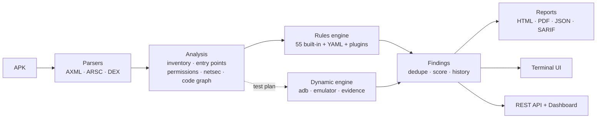

<div align="center">



<br>

**Open-source Android deep link and entry point security auditor.**
Static APK analysis · controlled dynamic testing · rules engine · evidence-backed findings · reports for people and pipelines.

<br>


<br>

[Quick start](#-quick-start) · [Features](#-features) · [Commands](#-command-reference) · [Dashboard](#-dashboard-and-rest-api) · [Project structure](#-project-structure) · [Docs](#-documentation)

<br>

Built by [**Karndeep Baror**](https://github.com/karndeepbaror) · [x.com/karndeepbaror](https://x.com/karndeepbaror)

</div>

---

## ✦ Why DEEPLINK X

Deep links, App Links, exported components and intent filters are the doors into an Android app. A single weakly guarded door can mean
account takeover, data theft or code execution through a crafted link. DEEPLINK X finds those doors, tells you how well each one is guarded,
and proves (on an emulator you control) whether they can be abused.

* **Self-contained.** Its own binary-XML, `resources.arsc` and DEX parsers. No Androguard, no apktool, no JVM.
* **Evidence, not noise.** Every finding carries severity, confidence, impact, affected component, evidence, reproduction steps and a fix.
* **One engine, every surface.** The terminal UI, REST API, web dashboard and all report formats consume the same report model.
* **Safe by design.** Dynamic testing is gated behind explicit authorisation and emulator-first policy.

---

## ✦ Quick start

> Requires **Python 3.10+**. The repository has the tool inside a `DeepLinkX` folder, so two `cd` commands are needed.

```bash
# 1. get the code
git clone https://github.com/karndeepbaror/deeplinkx.git
cd deeplinkx            # repository folder
cd DeepLinkX            # tool folder (this is where pyproject.toml lives)

# 2. create an isolated environment (recommended; required on newer Kali / Debian / Ubuntu)
python3 -m venv .venv
source .venv/bin/activate

# 3. install
pip install .

# 4. check and run
deeplinkx doctor        # verifies dependencies, adb and emulator
deeplinkx scan app.apk  # analyse, print summary, write HTML + JSON reports
```

<details>
<summary><b>Windows (PowerShell)</b></summary>

```powershell
git clone https://github.com/karndeepbaror/deeplinkx.git
cd deeplinkx
cd DeepLinkX
py -m venv .venv
.venv\Scripts\Activate.ps1
pip install .
deeplinkx doctor
```
</details>

<details>
<summary><b>Run without installing</b></summary>

```bash
cd deeplinkx/DeepLinkX
pip install -r <(python3 -c "import tomllib;print('\n'.join(tomllib.load(open('pyproject.toml','rb'))['project']['dependencies']))")
PYTHONPATH=src python3 -m deeplinkx --help
```
</details>

<details>
<summary><b>No internet on the machine?</b></summary>

`pip install .` needs to download the dependencies (`click`, `PyYAML`, `Jinja2`, `cryptography`, `reportlab`, `starlette`, `uvicorn`, `sse-starlette`).
On an offline machine, download the wheels on a connected one (`pip download . -d wheels`), copy the `wheels/` folder over, then run
`pip install --no-index --find-links wheels .`.
</details>

**No APK handy?** Build the bundled synthetic vulnerable demo app and scan it:

```bash
bash scripts/demo.sh
```

---

## ✦ Features

| | Area | What you get |
|---|---|---|
| 🔍 | **Static analysis** | Own AXML, ARSC and DEX parsers. Intent-filter and URI-scheme inspection, exported-component semantics (implicit export, provider defaults by `targetSdk`), permission and protection-level checks, network-security-config, signing schemes v1/v2/v3/v3.1, certificate checks, Digital Asset Links verification. |
| 🚪 | **Entry points** | Activities, services, receivers, providers and activity-aliases. Intent-filter association, guard strength (none / weak / medium / strong), unintended-entry detection (alias exposing a private activity, filterless explicit exports, implicit exports). |
| 🧬 | **Code reachability** | Call graph from lifecycle roots into sensitive APIs (WebView, SQL, file, exec, `startActivity`, `PendingIntent`), host-check classification (none / weak / strict), "intent data reaches sink" indicators. |
| 📏 | **Rules engine** | **55 built-in rules** in 7 categories, YAML custom rules, Python plugins, severity overrides, confidence levels, fingerprint de-duplication, risk scoring. |
| ⚡ | **Dynamic engine** | ADB and emulator integration, URI test-case generation (baseline, canary, redirect, traversal, injection-shaped, empty, oversized), launch observation, logcat / screenshot / UI evidence, reproducible `repro.sh`. |
| 🗂 | **Findings** | Persisted per app with status tracking: open, confirmed, false_positive, accepted, fixed. |
| 📄 | **Reports** | Self-contained **HTML**, **PDF**, **JSON** and **SARIF 2.1.0** (GitHub code scanning ready). |
| 🖥 | **Experience** | Animated terminal UI, interactive findings browser, REST API with live progress (SSE), web dashboard with attack-surface graph, scan profiles, batch analysis, history with diffing, Docker image. |

### Rule categories

| Category | Rules | Examples |
|---|---:|---|
| Input Handling | 14 | Unvalidated URI data reaching sinks, open redirects, path traversal shapes |
| Deep Link | 11 | Custom schemes without App Link verification, wildcard hosts, missing `autoVerify` |
| Exposure | 11 | Exported components without permission, alias exposing a private activity |
| Configuration | 10 | Debuggable, backup enabled, cleartext traffic, weak network security config |
| WebView | 4 | JavaScript bridges and file access reachable from links |
| Signing | 4 | Debug or weak certificates, missing modern signature schemes |
| Secrets | 1 | Hard-coded secrets and keys |

List and inspect them yourself: `deeplinkx rules list`, `deeplinkx rules show DLX-101`.

---

## ✦ How it works



The whole static pipeline produces **one JSON-able report model**. Terminal, API, dashboard, history and every report format read it, so they cannot drift apart.

---

## ✦ Command reference

### Scan

```bash
# standard scan, reports written to ./deeplinkx-reports
deeplinkx scan app.apk

# everything on, every report format, custom output folder, App Link verification
deeplinkx scan app.apk -p full -f html,json,pdf,sarif -o reports --assetlinks

# batch a whole folder with 4 parallel jobs, CI style (exit status 2 on findings)
deeplinkx scan ./apks/ -j 4 -p ci --fail-on high

# explore results in the interactive browser
deeplinkx scan app.apk -i

# machine-readable output only
deeplinkx scan app.apk --json > result.json
```

| Option | Purpose |
|---|---|
| `-p, --profile` | `quick`, `standard`, `full`, `ci`, or a path to your own YAML profile |
| `-f, --formats` | `html,json,pdf,sarif` (comma separated) |
| `-o, --out` | Report output directory (default `deeplinkx-reports`) |
| `--rules PATH` | Extra YAML rule file or directory |
| `--plugins PATH` | Plugin directory |
| `--assetlinks` | Verify `/.well-known/assetlinks.json` for App Links (uses the network) |
| `--no-code` | Skip DEX analysis (manifest only) |
| `--fail-on SEVERITY` | Exit with status 2 at or above this severity |
| `--min-severity`, `--min-confidence` | Hide weaker findings |
| `-j, --jobs N` | Parallel jobs for batch scans |
| `-i, --interactive` | Open the findings browser afterwards |
| `-q, --quiet`, `--top N`, `--no-history` | Output and history control |

### Inspect an APK

```bash
deeplinkx info app.apk        # package, SDK levels, signing, components
deeplinkx manifest app.apk    # decoded AndroidManifest.xml
deeplinkx links app.apk       # deep link and entry point inventory
```

### Dynamic testing (authorised test apps only)

```bash
deeplinkx dynamic app.apk --plan-only                     # show generated test cases, executes nothing
deeplinkx emulator list                                   # available emulators
deeplinkx scan app.apk --dynamic --authorized --install   # static + emulator run
deeplinkx scan app.apk --dynamic --authorized --serial emulator-5554 --evidence ./evidence
```

> Dynamic testing refuses to run without `--authorized`, prefers emulators, and needs `--allow-physical` for a real device. Read [docs/safety.md](docs/safety.md) first.

### History, findings and reports

```bash
deeplinkx history list                          # past scans
deeplinkx history show <id>
deeplinkx history diff <old-id> <new-id>        # what got fixed, what is new
deeplinkx finding list com.example.app
deeplinkx finding set-status com.example.app <finding-id> false_positive --note "checked, not exploitable"
deeplinkx report <scan-id> -f pdf,html          # re-render reports from a recorded scan
deeplinkx browse app.apk                        # interactive browser (APK or recorded scan)
```

### Rules, profiles and plugins

```bash
deeplinkx rules list                            # all rules
deeplinkx rules show DLX-101
deeplinkx rules validate my-rules.yaml          # check a custom rule file
deeplinkx profiles list
deeplinkx profiles show full
deeplinkx plugins list
```

### Global flags and exit codes

`--no-color` · `--color` · `--no-anim` · `--version` · `--help` (also on every sub-command). `NO_COLOR` is honoured; colour depth is auto-detected.

| Code | Meaning |
|---:|---|
| `0` | Success |
| `1` | Error (bad input, unreadable APK…) |
| `2` | Findings at or above `--fail-on` severity (and `--min-confidence`) |
| `3` | Safety refusal (dynamic testing without authorisation, physical device without opt-in…) |

### Scan profiles

| Profile | Use it for |
|---|---|
| `quick` | Manifest-only triage, fast on large APKs |
| `standard` | Balanced static assessment with code indicators |
| `full` | Everything: DEX analysis, App Link verification, wide dynamic coverage |
| `ci` | Pipelines: firm findings only, fails the build on High |

Profiles are plain YAML in [`src/deeplinkx/profiles/`](src/deeplinkx/profiles). Pass a file path to `-p` to use your own.

---

## ✦ Dashboard and REST API

```bash
deeplinkx serve --token "$(openssl rand -hex 16)" --open
```

Opens the dashboard at **http://127.0.0.1:8787** (change with `--host` / `--port`).

* Drag-and-drop APK upload with live progress
* Filterable findings with status tracking
* Deep link and entry point inventories
* Interactive attack-surface graph
* History, diff and downloads for every report format
* Plain ES modules, no build step

The API uses bearer-token auth (`--token` or `DEEPLINKX_API_TOKEN`). Full reference: [docs/api.md](docs/api.md). A dependency-free Python client ships in `deeplinkx.api.client`.

> Binds to `127.0.0.1` by default. Always set a token before exposing it on another interface.

---

## ✦ Docker

```bash
export DEEPLINKX_API_TOKEN=change-me
docker compose up --build                                   # dashboard on http://127.0.0.1:8787
docker run --rm -v "$PWD:/work" deeplinkx:1.0.0 scan app.apk -o reports
```

Details: [docs/docker.md](docs/docker.md).

---

## ✦ CI integration

Drop-in GitHub Actions workflow: [`docs/ci-github-actions.yml`](docs/ci-github-actions.yml).

```bash
deeplinkx scan app.apk -p ci -f sarif,json --fail-on high
```

Upload the SARIF file to GitHub code scanning to see findings on pull requests.

---

## ✦ Extending

| Extension | How |
|---|---|
| **Custom rules** | Declarative YAML, validated on load. See [docs/rules.md](docs/rules.md) and [`rules/example-org-policy.yaml`](rules/example-org-policy.yaml). |
| **Plugins** | Python `register(api)` for rules, dynamic test-case generators and report sections. See [docs/plugins.md](docs/plugins.md) and [`plugins/example_plugin.py`](plugins/example_plugin.py). |
| **Auto-load** | Files in `~/.deeplinkx/rules/` and `~/.deeplinkx/plugins/` load automatically. `DEEPLINKX_HOME` relocates the directory. |

---

## ✦ Project structure

```
deeplinkx/                     ← GitHub repository
└── DeepLinkX/                 ← the tool (run pip install . from here)
    ├── pyproject.toml         package metadata, dependencies, `deeplinkx` entry point
    ├── README.md              this file
    ├── LICENSE                MIT
    ├── Dockerfile             container image
    ├── docker-compose.yml     dashboard + API in one command
    │
    ├── src/deeplinkx/         ── the application ──
    │   ├── cli/               click commands (scan, dynamic, links, serve, …)
    │   ├── apk/               binary AXML, resources.arsc, DEX, ZIP and signing-block parsers
    │   ├── analysis/          inventory, entry points, permissions, netsec, code graph, assetlinks
    │   ├── rules/             55 built-in rules, YAML rules, plugin loader
    │   ├── findings/          rule runner, de-duplication, scoring, SQLite history store
    │   ├── dynamic/           safety policy, adb wrapper, emulator, test cases, observer, evidence
    │   ├── reports/           HTML (Jinja2), PDF (reportlab), JSON, SARIF
    │   ├── api/               Starlette REST + SSE, job manager, graph builder, Python client
    │   ├── web/               dashboard: index.html, css/, js/ (ES modules, canvas graph)
    │   ├── ui/                animated terminal UI, widgets, live scan view, findings browser
    │   ├── profiles/          quick / standard / full / ci scan profiles (YAML)
    │   ├── scan.py            the whole static pipeline → one report model
    │   ├── models.py          shared data models
    │   ├── config.py          settings and paths
    │   └── errors.py          exception types
    │
    ├── assets/                banner.svg (README header)
    ├── rules/                 example custom YAML rule pack
    ├── plugins/               example Python plugin
    ├── profiles/              profile samples
    ├── scripts/               demo.sh (build and scan a demo app), build_zip.py
    ├── docs/                  api · architecture · docker · plugins · rules · safety · CI workflow
    └── tests/                 76 tests: parsers, analysis, rules, dynamic (fake adb), reports, CLI, API, web
```

---

## ✦ Development

```bash
cd deeplinkx/DeepLinkX
python3 -m venv .venv && source .venv/bin/activate
pip install -e ".[dev]"
pytest
```

Test APKs are generated by `tests/fixtures/builders.py` (binary AXML, ARSC, DEX and signed-APK writers), so the parsers are exercised by
round trip against independently constructed binaries. Architecture notes: [docs/architecture.md](docs/architecture.md).

---

## ✦ Documentation

| Guide | Contents |
|---|---|
| [docs/architecture.md](docs/architecture.md) | Pipeline, design rules, risk scoring |
| [docs/rules.md](docs/rules.md) | Writing YAML rules |
| [docs/plugins.md](docs/plugins.md) | Plugin API |
| [docs/api.md](docs/api.md) | REST endpoints |
| [docs/docker.md](docs/docker.md) | Container usage |
| [docs/safety.md](docs/safety.md) | Authorisation and safe dynamic testing |
| [docs/ci-github-actions.yml](docs/ci-github-actions.yml) | CI workflow |

---

## ✦ Troubleshooting

| Problem | Fix |
|---|---|
| `externally-managed-environment` on `pip install` | Use a virtual environment (`python3 -m venv .venv && source .venv/bin/activate`) |
| `No matching distribution` / DNS or connection error | The machine is offline. Connect to the internet, or use the offline wheels method above |
| `pyproject.toml not found` | You are in the outer folder. Run `cd DeepLinkX` and retry |
| `deeplinkx: command not found` | Activate the venv, or run `python3 -m deeplinkx` |
| `adb` not found in `doctor` | Install Android platform-tools and put `adb` on `PATH`, or pass `--adb /path/to/adb` |
| Colours or animation look wrong | Use `--no-color` and `--no-anim` |

---

## ✦ Honest limits

* DEX analysis is a conservative call-graph over-approximation, not full data-flow analysis. Code-level results are **indicators to verify**; that is what dynamic confirmation is for.
* Obfuscated or packed apps (runtime-decrypted DEX, native-only logic) are only partly visible to static analysis.
* The dynamic engine was developed against a scripted `adb` double. Run it against your own emulator and read the evidence before trusting a result.

## ✦ Responsible use

Test only applications you own or are explicitly authorised to test. DEEPLINK X is for defenders, developers, bug-bounty hunters working within programme scope, and students learning mobile security. The authors accept no liability for misuse.

---

<div align="center">

**DEEPLINK X** · MIT License · Made by [Karndeep Baror](https://github.com/karndeepbaror)

If this tool helps you, a ⭐ on the repository means a lot.

</div>
